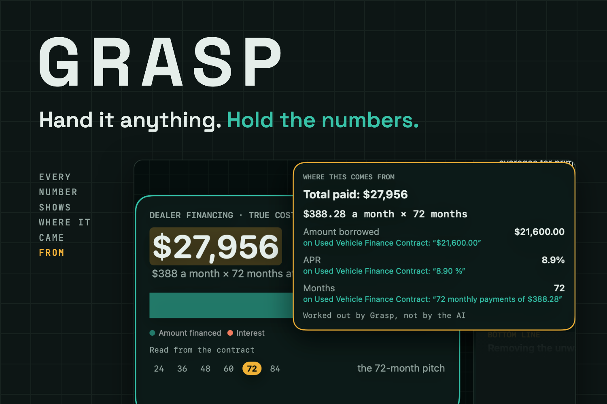
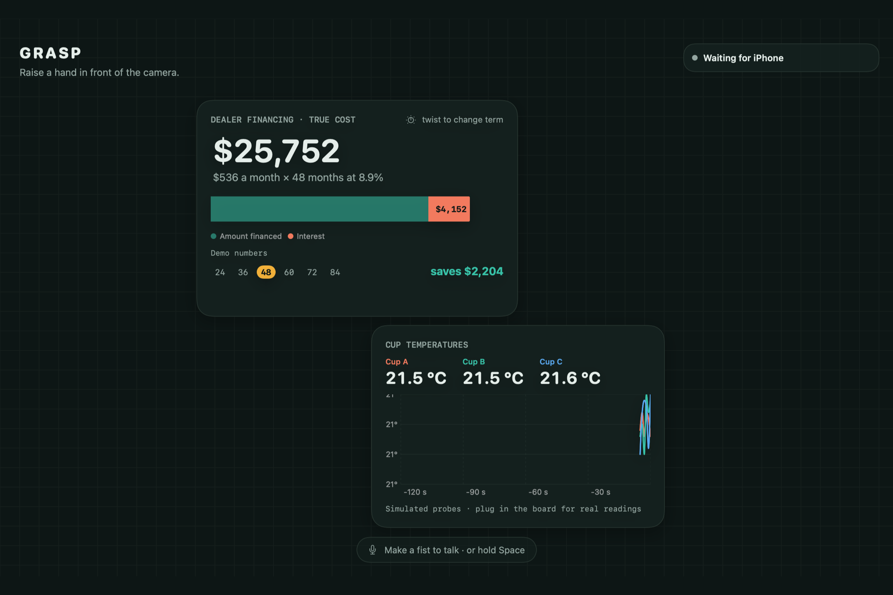
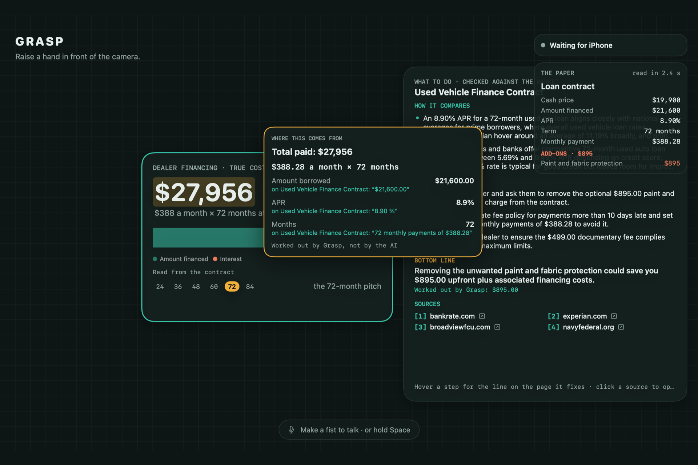
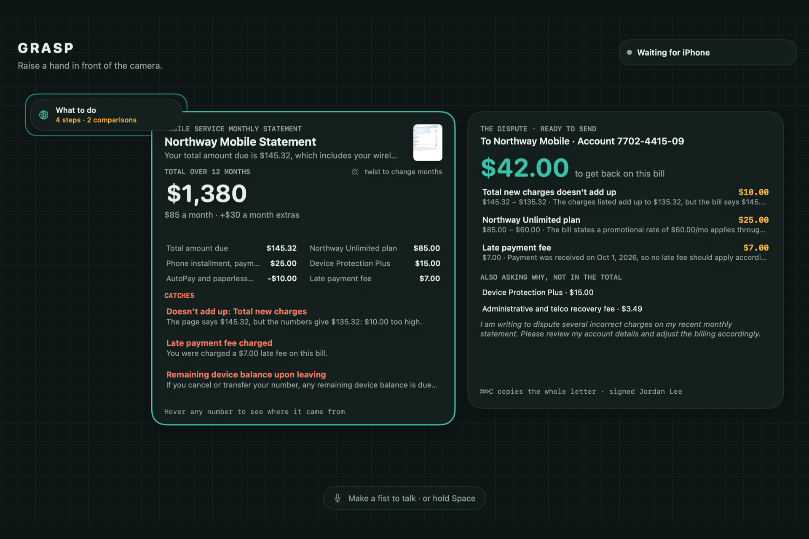
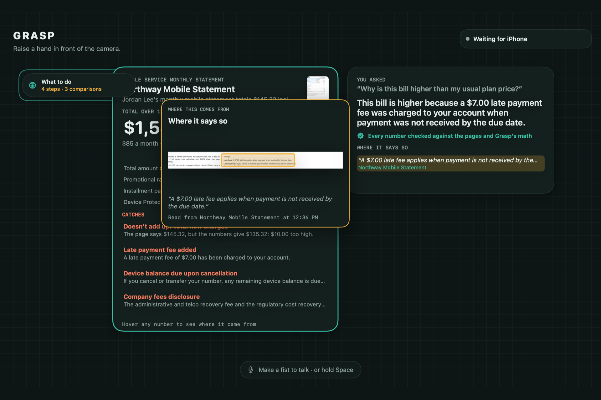
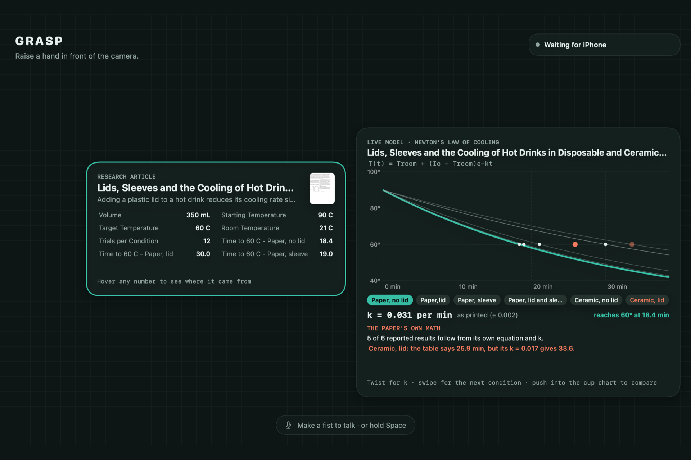
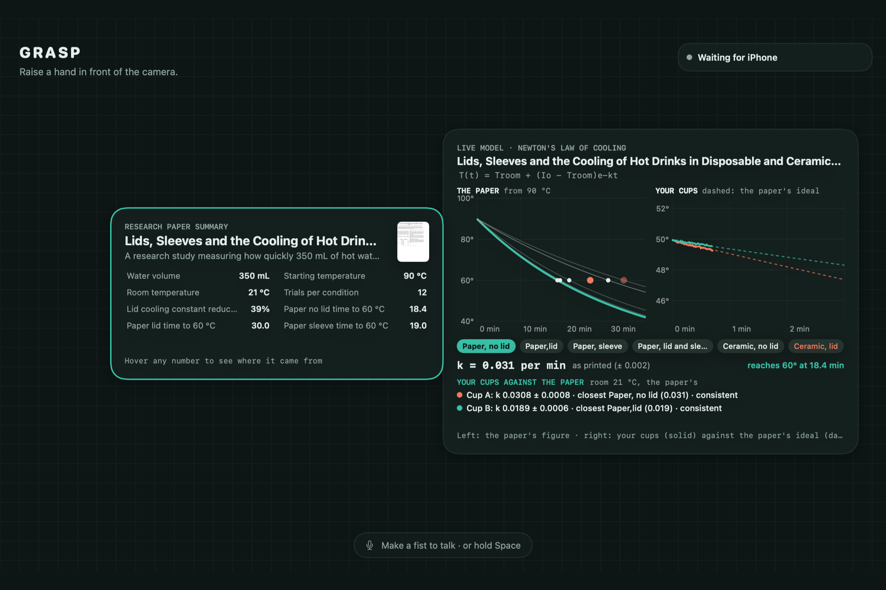
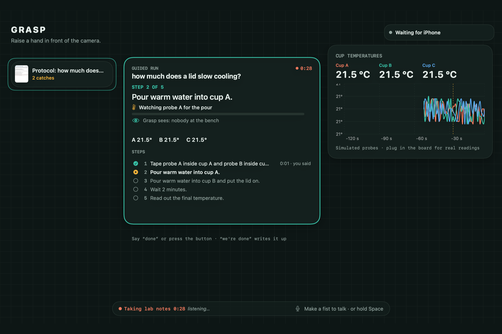
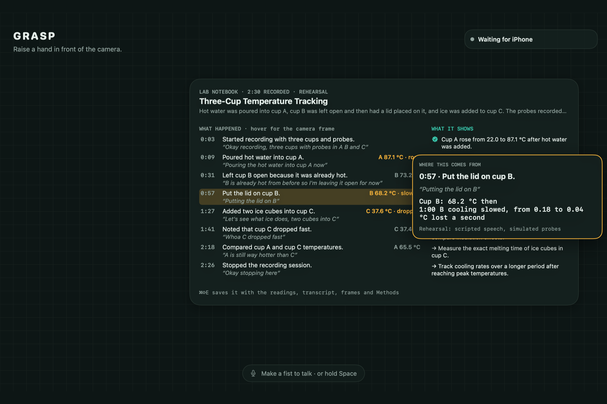
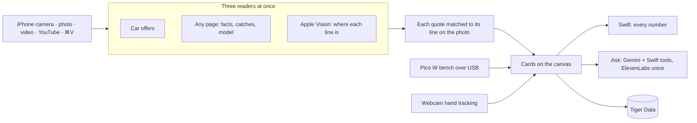

# Grasp

**Grab what you see and hear. Understand it with your hands.**



Hand Grasp anything with numbers on it: a car contract, a phone bill, a research paper, a lecture, the lab bench. It reads it, **every number shows where it came from**, you hold and twist the numbers with your bare hands, and you can ask it anything. It answers out loud, pointing at the exact line.

Built at HackPSU Fall 2026.

## What it does

Grasp is one engine, not a set of modes. Every page or video goes through it:

| | |
|---|---|
| **Read anything** | Any page or video becomes a card: what it is, the numbers that matter, the catches in the fine print, and a model when the numbers allow one. |
| **Receipts for every number** | Hover a fact for its crop of the photo. Hover a computed number for its formula, each input traced to its words on the page. |
| **Does it add up?** | Every total, rate and percentage is rechecked in Swift. A wrong one becomes a red catch with the right number. |
| **Hold it** | The Mac's webcam tracks both hands: pinch, twist a dial, push two cards together, thumbs up, two-hand zoom, swipe, trash. |
| **Ask anything** | Make a fist, hold Space, or type with ⌘K in a loud room. Answers are read aloud with the source sentence highlighted; Swift calculator tools do the math. |
| **Money** | True cost of a loan, twist the term, compare offers, what to say to the dealer, a dispute letter for a bill, and a "What to do" plan checked against current prices. |
| **Research** | A paper becomes a live model that re-derives every reported result; your cups' cooling rates are fitted against it live; a method map; related work from OpenAlex; your notes checked against the paper. |
| **Guided experiment** | Steps read aloud and shown on the bench's LCD, pours confirmed by the probes, everything else by the camera. Hands-free: "done", "go back", "we're done". |
| **Lab notebook** | Camera frames, speech and probe readings become a notebook with Methods, CSV, transcript and a captioned time-lapse. |
| **Study** | A lecture or YouTube link becomes a page with moments, facts at the second they're said, and notes stamped with the time. |
| **Deep dive** | Zoom in with both hands for web findings, each backed by a numbered source. |

## Screenshots

| | |
|---|---|
|  |  |
| Twist your wrist: 48 months saves $2,204. | Hover a number for its formula and sources. |
|  |  |
| A phone bill becomes a $42.00 dispute letter. | Ask out loud, get the sentence it came from. |
|  |  |
| A paper becomes a live model and gets checked. | Your cups' cooling rates against the paper's. |
|  |  |
| A guided run, confirmed by the probes. | The notebook writes itself. |

More in [`media/screens`](media/screens).

## How it works



- **The AI reads; Swift does the math.** Gemini 3.5 Flash-Lite with a JSON response schema reads each page. Payments, totals, the arithmetic check and the cooling fits are all computed in Swift. An answer containing a number Grasp can't trace is marked unchecked.
- **Mac, iPhone, bench.** The macOS app is the brain and the canvas. The iOS app is a camera that sends frames over Multipeer Connectivity (no Wi-Fi needed). A Raspberry Pi Pico W reads two sealed thermistor cups, a DHT11 for room air, an LCD and a buzzer over USB serial. Without the board, a simulated bench speaks the same protocol.
- **No third-party Swift packages.** Even the Postgres client for Tiger Data (TLS, SCRAM-SHA-256) is written from scratch.

## Run it

You need a Mac with macOS 15 or later and a recent Xcode. An iPhone (iOS 18) is optional: without one, run GraspPhone in the simulator and it sends test frames.

1. Add your keys:

   ```bash
   cp Config/Secrets.example.xcconfig Config/Secrets.xcconfig
   ```

   Fill in `GEMINI_API_KEY`, `ELEVENLABS_API_KEY` and, to save to Tiger Data, `TIGER_SERVICE`. The file is git-ignored.

2. Open `Grasp.xcodeproj` and run the **GraspMac** scheme on My Mac, and **GraspPhone** on your iPhone. Or build from the command line:

   ```bash
   xcodebuild -project Grasp.xcodeproj -scheme GraspMac -destination 'platform=macOS' build
   ```

3. Hand it something: print anything in [`props/`](props) (a car contract, a phone bill, a paper, a protocol) and hold it up to the phone, or press ⌘O for a photo or video. ⌘R lays out the demo car loan.

Useful shortcuts (every gesture has one, in the Canvas menu):

| Keys | Does |
|---|---|
| Space (hold) or a fist | Talk to Grasp |
| ⌘K, or click the bar | Type a question or command (for a loud room) |
| ⌘O / ⌘V | Read a photo or video / paste a YouTube link, photo or file |
| ⌘J | What to say, read aloud |
| ⌘⇧W | Write the dispute letter |
| ⌘⇧A | What to do about this page |
| ⌘⇧D | Deep dive |
| ⌘⇧G, ⌘⏎ | Start the guided protocol, next step |
| ⌘⇧R, ⌘⇧E | Start or stop lab notes, save the notebook |
| ⌘⇧B | Compare your cups with the paper |
| ⌘⇧M, ⌘⇧F | Map the method, find related work |

## The bench

The firmware is [`firmware/pico/main.py`](firmware/pico/main.py) (MicroPython for the Raspberry Pi Pico W; save it to the board as `main.py`). It sends `T,A,44.21`-style readings once a second and accepts `LCD,<text>`, `BEEP`, `TARGET,<c>` and `CAL`. Grasp finds the board on USB by itself. Quit Thonny before running Grasp, since only one program can hold the port. The wiring is at the top of `main.py`, and the serial protocol is in [`docs/SENSORS.md`](docs/SENSORS.md).

## Tests

```bash
cd GraspKit && swift test
```

183 offline tests cover the math, gestures, readers' parsing, the bench protocol and more. Live batteries run against Gemini when `GEMINI_API_KEY` is set. On five test documents with six planted arithmetic mistakes, Grasp caught all six in 3 of 3 runs with no false alarms, and answered 59 of 60 follow-up questions right. The answer key is [`props/TEST-DOCUMENTS.md`](props/TEST-DOCUMENTS.md).

## Repository

```
GraspKit/     Shared Swift package: math, gestures, AI readers, bench protocol, storage, with tests
GraspMac/     The macOS app: canvas, hands, voice, bench, modes, export
GraspPhone/   The iOS app: the camera
firmware/     Pico W firmware
props/        Printable demo documents and their answer key
media/        Thumbnail and screenshots
docs/         Sensors brief, Devpost text, video script
```

[`GRASP.md`](GRASP.md) is the full project brief: features, demo scripts, math and build plan.

## Built with

Swift, SwiftUI, Swift Charts, Apple Vision, Apple Speech, AVFoundation, Multipeer Connectivity, Gemini 3.5 Flash-Lite, Google Search grounding, ElevenLabs, Tiger Data (TimescaleDB), OpenAlex, Raspberry Pi Pico W, MicroPython.

## Team

[Team names]

## License

[MIT](LICENSE)
